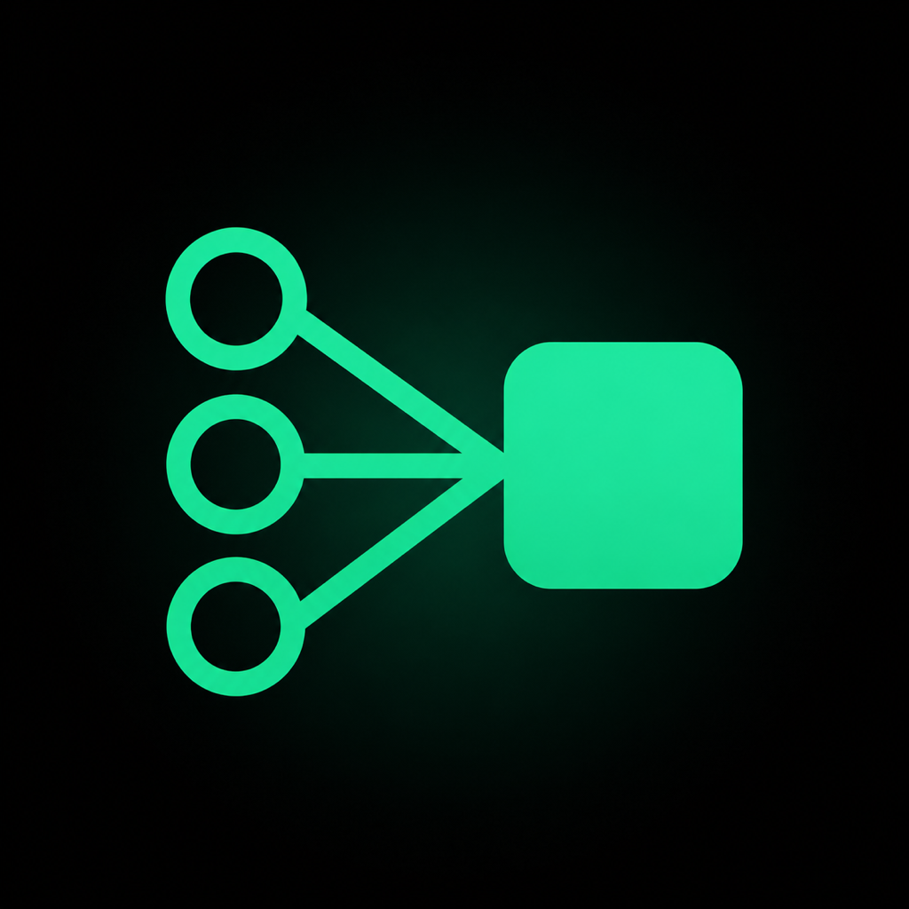

<div align="center">
  

  # One-Shot

  **Desktop context builder for LLMs — Wails, Go & React.**

  English · [Español](README.es.md)
</div>

Every chatbot needs codebase context. One-Shot builds it on your machine: no API key, no remote server, zero cloud dependencies.

One-Shot scans your repository, lets you select the relevant files, and compiles a **single, structured payload** containing your project tree, dependency graph, and source code. Copy it to your system clipboard and paste it into ChatGPT, Claude, Kimi, or any other chatbot.

No bundled AI providers. No API keys. No network telemetry. Just context packaging.

The interface and the generated payload are in Spanish, so this README quotes the labels exactly as the app shows them.

---

## What It Generates

One-Shot formats your codebase into one hierarchical message:

```markdown
# Codebase: my-project

53 archivos de texto · 176.3 KB · ~45.1k tokens aprox.
Contexto generado con One-Shot. Todo lo necesario esta en este mensaje.

## Objetivo                         ← your goal for the model, if you typed one
## Estructura                       ← ASCII tree of the selected files
## Grafo de dependencias
   Puntos de entrada                ← files that nothing else in the selection imports
   Dependencias externas mas usadas ← react (23), lucide-react (11)...
   Mapa modulo por modulo           ← per file: what it defines, what it imports, who uses it
## Recursos binarios                ← images and assets: path and size, never raw bytes
## Archivos                         ← the source code, in fenced blocks per language
```

- **Binary files are listed, never transcribed**: files are classified by content, git-style: a NUL byte, or more than 10% invalid UTF-8, in the first 8 KB marks a file as binary (images, fonts, compiled artifacts). Binaries appear in the tree and under `Recursos binarios` with their size, so the model knows they exist, but their bytes never reach the clipboard.
- **Per-language dependency graph**: imports are extracted with per-language patterns for TypeScript/JavaScript, Go, Python, and CSS. Relative TS/JS/CSS imports resolve to project files (including `index.*` and `.js` → `.ts`), and Go imports resolve to the files of the package folder. Python imports are not resolved to files yet: absolute ones are listed as external names and relative ones are skipped. The Go standard library is left out of the external dependency count.

---

## Key Features

- **Transitive dependencies**: select files and press **+ Dependencias**. One-Shot walks the import graph of the whole project and adds every file your selection imports, transitively.
- **Native clipboard**: copying happens in Go (`runtime.ClipboardSetText`), not in the webview, where `navigator.clipboard` fails on large payloads or without a direct user gesture.
- **Live token estimate**: roughly one token per 4 bytes, updated as you select (binaries excluded). Above 200k tokens, where most chats reject a single paste, the counter is flagged with a warning.
- **Section toggles**: switch `Estructura`, `Grafo`, and `Codigo` on or off independently. With `Codigo` off you get an architectural summary that costs few tokens.
- **Zero cloud footprint**: runs strictly on your machine. Your code never goes through a proxy or a third-party server.
- **Session persistence**: reopens your last repository, file selection, and options. Files that no longer exist are dropped on rescan.

---

## Usage

1. Launch One-Shot, press **Abrir Repositorio**, and pick your repository folder.
2. Tick files or folders, or use the quick filters (`Todo` / `Fuente` / `Config`).
3. *(Optional)* Type the goal you want the model to work on.
4. Press **copiar todo** (`⌘/Ctrl + Enter`) and paste the payload into your chat.

`Vista previa` shows the payload before you copy it, `Guardar .md` writes it to disk, and the ChatGPT, Claude, and Kimi buttons open those chats in your browser. `⌘/Ctrl + K` jumps to the file filter.

### Transitive Context (`+ Dependencias`)

Select your target file and press **+ Dependencias**. One-Shot follows the full import chain across the project (TS/JS/CSS and Go) and selects every file it depends on, so you don't have to chase imports by hand.

---

## Installation & Quickstart

### Prerequisites

- [Go](https://go.dev/) 1.24 or higher
- [Node.js](https://nodejs.org/) 20.19+ or 22.12+
- [Wails](https://wails.io/) v2 CLI (`go install github.com/wailsapp/wails/v2/cmd/wails@latest`)

### Build from Source

```bash
# Clone the repository
git clone https://github.com/obeskay/one-shot.git
cd one-shot

# Install frontend dependencies
npm install

# Run live development mode
wails dev

# Build production binary (outputs to build/bin)
wails build
```

---

## Architecture & Tech Stack

- **Backend**: Go 1.24 (directory scanner, pattern-based import graph, payload builder, native OS clipboard)
- **Frontend**: React 19, TypeScript, Tailwind CSS v4
- **Desktop Runtime**: Wails v2

```
one-shot/
├── main.go               Application entry point & Wails bootstrap
├── internal/
│   ├── app/              Wails lifecycle, project state, clipboard bridge
│   ├── domain/           Core types (Project, FileNode, TreeSnapshot) and their DTOs
│   ├── fs/               Local filesystem scanner & binary detection heuristics
│   ├── graph/            Language-specific import extraction (Go, TS/JS, Python, CSS)
│   ├── ignore/           .gitignore & default exclude rules
│   └── payload/          Payload assembly & token estimate
├── components/           React UI components & layout
└── services/             Wails bridge & session persistence
```

---

## Verification & Tests

```bash
# Run Go unit tests
go test ./internal/...

# Run frontend typecheck
npm run typecheck
```

---

## Design Rationale: Why It Stayed Simple

One-Shot began as a focused context builder. Over successive iterations, feature bloat took over: bundled API clients for OpenAI, Anthropic, and Gemini, streaming chat components, API key management wizards, and local CLI agent detectors.

The tipping point arrived when the app threw `provider not registered: agy` at the user: a provider ID the UI offered and the backend never registered. At the same time, the actual "Copy" button, the entire value proposition of the product, lived in a component that was never mounted.

The fix was not patching the provider registry. The fix was deleting it: `internal/llm`, `internal/secrets`, `internal/jobs`, the setup wizard, and the chat UI. **24,000 lines were deleted in a single cut.**

A tool with a single responsibility (turning a file selection into a context block) has no place for hidden errors. If it fails, the failure is visible in your clipboard immediately. Once a tool bundles four external APIs, stores secrets in the OS keyring, streams responses, and probes your shell `$PATH`, failure happens three abstraction layers away from the root cause.

In modern agentic workflows, value comes from **discrete, verifiable checkpoints** orchestrated by the developer. Input: a selection of files. Output: a structured context block. You paste it where you want; the paste either works or it does not. Downstream inference belongs to the tools built for it (ChatGPT, Claude, Kimi).

One-Shot deliberately contains zero AI providers. That boundary ensures that the limits of the software match the exact boundaries where you can verify its work.

---

## License

MIT. See [LICENSE](LICENSE).
